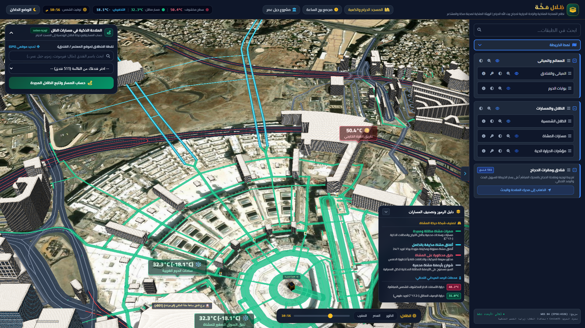
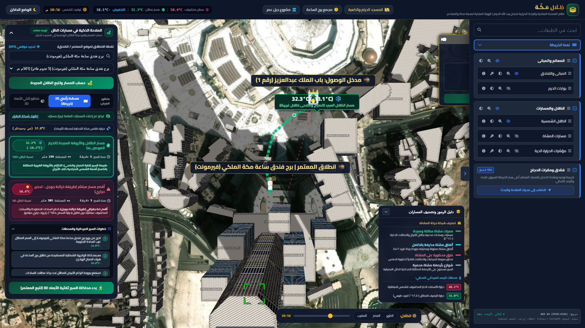
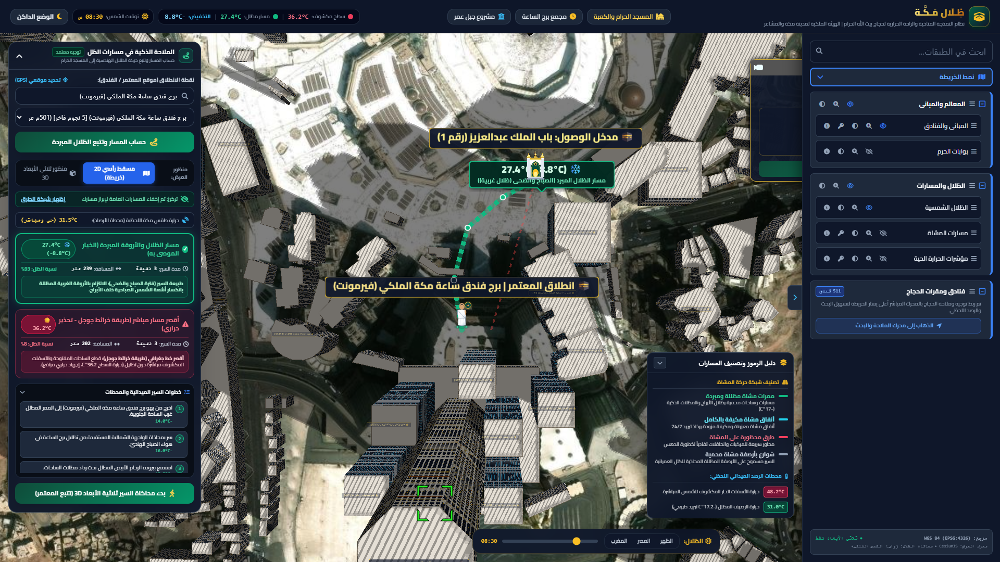
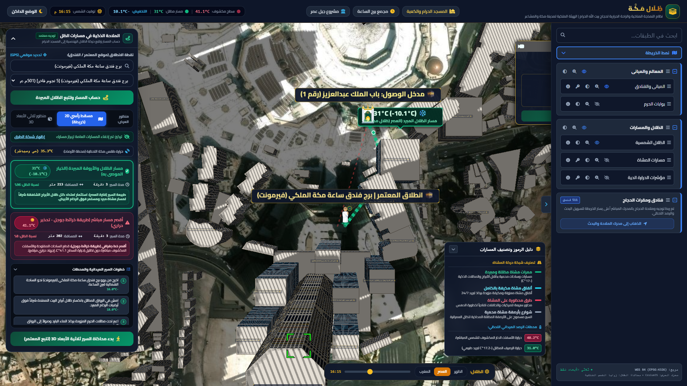
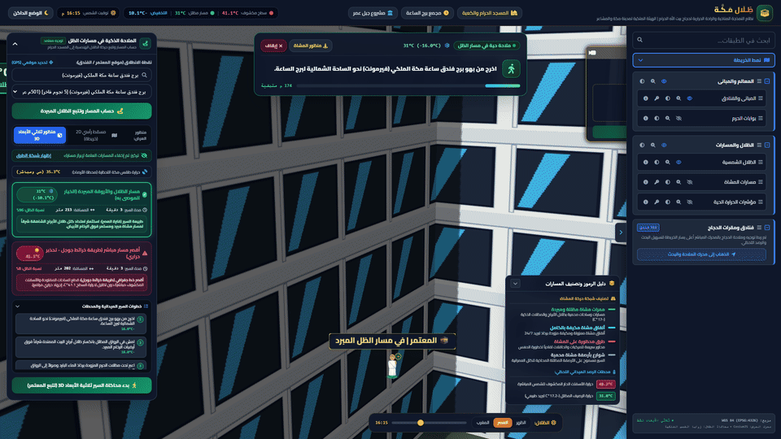
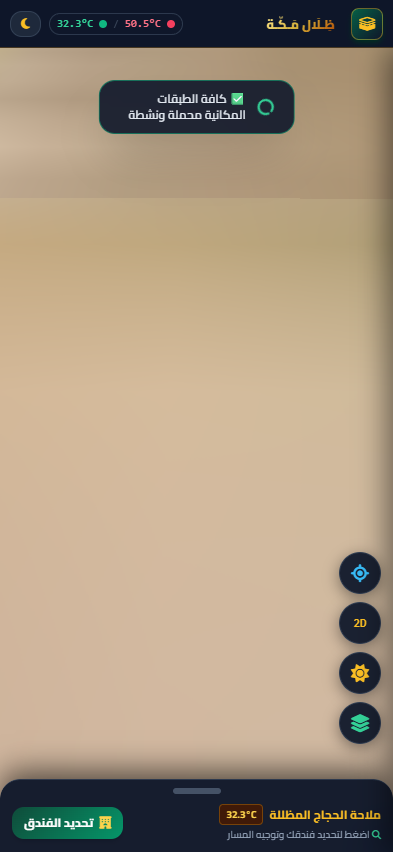
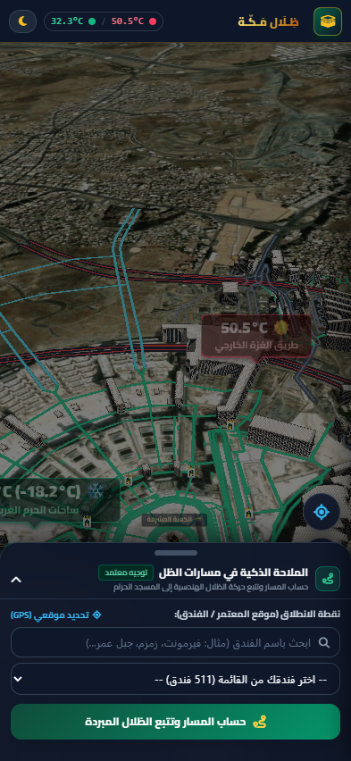

# 🕋 ظِـلَال مَـكَّـة (Zilal Makkah 3D)
### أول نظام ملاحة مناخي وجغرافي ذكي ثلاثي الأبعاد لحماية ضيوف الرحمن من الإجهاد الحراري

[](https://ashehta700.github.io/zilal-makkah/)
[](https://cesium.com/)
[](LICENSE)
[](https://www.vision2030.gov.sa/)

> **«مشروع وقف تقني لوجه الله تعالى مسخر لخدمة حجاج ومعتمري بيت الله الحرام ووقايتهم من ضربات الشمس والإجهاد الحراري في المشاعر المقدسة»**

---

## 🌐 التجربة المباشرة (Live Demo)
يمكنك تجربة التطبيق مباشرة عبر متصفحك أو هاتفك الذكي من خلال الرابط:  
👉 **[https://ashehta700.github.io/zilal-makkah/](https://ashehta700.github.io/zilal-makkah/)**

---

## 💡 فكرة المشروع والمشكلة التي يعالجها

في موسم الحج والصيف بالعاصمة المقدسة، تتجاوز درجات حرارة الأسطح والأسفلت المكشوف **50 درجة مئوية**.  
أنظمة الملاحة التقليدية (مثل خرائط جوجل وغيرها) توجّه المشاة دائماً في **أقصر خط جغرافي**، لكنها لا تبالي بكون هذا الطريق يمر تحت أشعة الشمس الحارقة أو يعرّض كبار السن وضيوف الرحمن لمخاطر ضربات الشمس القاتلة.

من هنا ابتُكر تطبيق **«ظِلال مكّة»**:  
نظام ملاحي تفاعلي يحلل البيئة المناخية والمعمارية لمحيط المسجد الحرام، ويضع أمام المعتمر خيارين حراريين لحظيين:
1. 🔴 **المسار الأحمر (طريقة جوجل):** أقصر طريق مكشوف | حرارة السطح تصل إلى **50.0°C** | نسبة الظل **8%** | تحذير حراري أحمر.
2. 🟢 **مسار ظِلال مكّة (الموصى به):** مسار الأروقة المبردة | حرارة الرخام والمسار المظلل **28.4°C** | نسبة الظل **98%** | فارق تبريد يتجاوز **-21.6°C** عبر شبكة الأروقة المعمارية، المظلات العملاقة، وأعمدة رذاذ الماء التبخيري.

---

## ✨ أبرز الميزات والابتكارات التقنية

### 1️⃣ تتبع حركة الشمس الفلكية وزوايا الظلال اللحظية (Dynamic Solar Tracking)
* المسار الأخضر ليس خطاً ثابتاً، بل خوارزمية ذكية تتتبع موقع الشمس الفلكي وزاوية سمتها وارتفاعها دقيقة بدقيقة.
* **فترة الضحى (الصباح):** ينحرف المسار غرباً في ظل أبراج البيت الشاهقة فوق رخام ثاسوس الأبيض.
* **فترة الظهر:** يلتزم المسار بممرات الأعمدة المبردة ومظلات الرذاذ التبخيري.
* **فترة العصر:** مع انكسار الشمس غرباً، يمتد ظل الأبراج شرقاً بأكثر من 110 أمتار ليتحول المسار تلقائياً عبر الساحات الشرقية نحو أبراج الصفوة.

### 2️⃣ قاعدة بيانات ثلاثية الأبعاد متكاملة لمعالم مكة (3D GIS Engine)
* قاعدة بيانات جغرافية تضم أكثر من **510 فندق ومعلم تاريخي وباب من أبواب الحرم المكي**.
* مجسمات ثلاثية الأبعاد تحاكي ناطحات السحاب ومشاريع التطوير الكبرى (مجمع برج الساعة، جبل عمر، أبراج كدي، أجياد، جرول).
* نمذجة طبوغرافية دقيقة للمرتفعات الجبلية المحيطة بالمسجد الحرام (جبل أبي قبيس، جبل خندمة، جبل الكعبة).

### 3️⃣ محاكاة سير المعتمر ثلاثية الأبعاد (3D Pilgrim Tracking & HUD)
* تجسيد حي للمعتمر بملابس الإحرام والهالة الضوئية أثناء تقدمه نحو بوابات الحرم الشريف (مثل باب الملك عبدالعزيز، باب الملك فهد، باب السلام).
* شريط مؤشرات رأسية لحظية (HUD) يوضح للمعتمر: درجات الحرارة السطحية، أماكن شرب مياه زمزم، محطات التبريد بالرذاذ، وأقرب نقاط الإسعاف.

### 4️⃣ واجهة متجاوبة بالكامل للهواتف الذكية (Google Maps UI Sheet)
* تصميم سلس يشبه واجهة خرائط جوجل الرسمية، مع شريط تلخيص سريع (Peek Bar) وقائمة سحب ذكية (Bottom Sheet).
* كاشف GPS لحظي للموقع الجغرافي للمعتمر، ويدعم تغيير التاريخ والوقت لمحاكاة الظلال لأي يوم في السنة.

---

## 📸 لقطات من التطبيق (Screenshots & Demos)

### 1. نظرة عامة على الحرم والأبراج ثلاثية الأبعاد


### 2. مقارنة المسارين المزدوجين (الأحمر المكشوف مقابل الأخضر المظلل)


### 3. تكيف المسار مع الظلال الصباحية والعصرية
| الظل الصباحي (الضحى 08:30 ص) | الظل العصري (العصر 04:15 م) |
| :---: | :---: |
|  |  |

### 4. محاكاة السير الميداني ثلاثية الأبعاد


### 5. تجربة الجوال المتجاوبة
| شريط التلخيص السريع (Peek Bar) | قائمة خطوات السير المفصلة |
| :---: | :---: |
|  |  |

---

## 🛠️ البنية التقنية (Architecture & Stack)

* **محرك الرسوميات الجغرافية (3D Core):** [CesiumJS](https://cesium.com/) 1.118
* **البيانات المكانية (Spatial Data):** GeoJSON & EPSG:4326 (WGS 84) Pedestrian Network & 3D Building Extrusions
* **واجهة المستخدم (UI/UX):** HTML5, Tailwind CSS, FontAwesome 6, Google Fonts (Cairo & Tajawal)
* **الحسابات الفلكية والمناخية:** خوارزميات حساب زوايا سمت الشمس (Solar Azimuth & Elevation) وحسابات التبادل الحراري لأسطح الرخام والأسفلت
* **التوافقية:** يعمل 100% بدون أي سيرفر خلفي (Serverless Static Single Page Application) على كافة الأجهزة والمتصفحات.

---

## 🚀 التشغيل المحلي (Local Development)

لتشغيل المشروع محلياً على جهازك:

```bash
# 1. استنساخ المستودع
git clone https://github.com/ashehta700/zilal-makkah.git

# 2. الدخول إلى المجلد
cd zilal-makkah

# 3. تشغيل أي سيرفر محلي (مثل خادم بايثون السريع)
python -m http.server 8080
```

افتح المتصفح على: `http://localhost:8080`

---

## 📄 الترخيص (License)
هذا المشروع متاح بموجب ترخيص **MIT License** كوقف تقني مفتوح المصدر لخدمة ضيوف الرحمن وتطوير الحلول الذكية في المدن المقدسة.

---

### 👨‍💻 إشراف وتطوير:
**أحمد شحاتة (Ahmed Shehta)**  
*مهندس برمجيات ومطور حلول جغرافية وذكاء اصطناعي*  
📧 البريد الإلكتروني: `ashehta700@gmail.com`  
🐙 جيت هاب: [@ashehta700](https://github.com/ashehta700)
